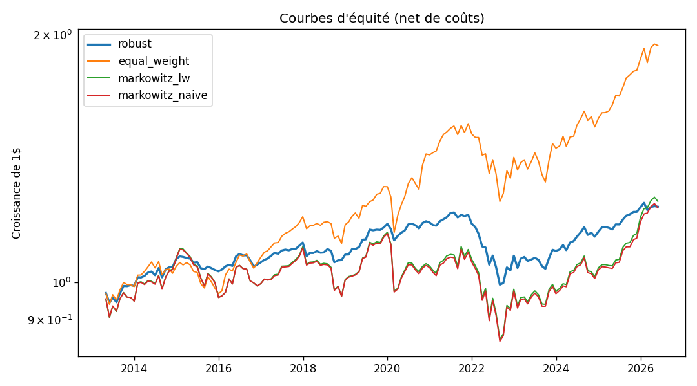
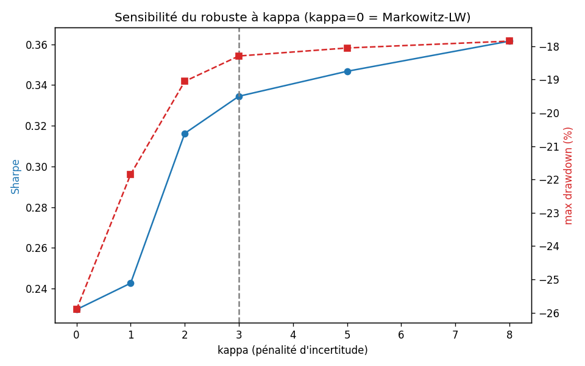

# portfolio_optimization: Portfolio allocation under uncertainty
 
> **Result (one sentence).** Quantifying the uncertainty of return forecasts
> and feeding it into a robust optimizer **fixes the instability of Markowitz**:
> over a 2013→2026 backtest, the Sharpe ratio rises from 0.23 to **0.33**, the max drawdown
> goes from −26% to **−18%**, and turnover is **divided by ~2**. The gain is *attributed*
> to the uncertainty layer (ablation) and is *monotone* across the whole parameter range.
> 1/N remains a demanding benchmark (Sharpe 0.62), discussed honestly below.
 
This project **is not a benchmark of methods**. It is an allocation **decision**
and the measurement of its **impact**. Architecture comparisons
(LSTM vs ARIMA, bootstrap vs MC Dropout vs VAE) are *implementation details*
to be documented in an appendix (planned). A single winning combination is highlighted in the
main pipeline.
 
---
 
## The 4-layer pipeline
 
```
            ┌─────────────────────────────────────────────────────────────┐
 Layer 0    │  DATA  (src/etl, src/features)                               │
            │  ETF universe → clean price/return panel (parquet)           │
            └─────────────────────────────────────────────────────────────┘
                                      │
            ┌─────────────────────────────────────────────────────────────┐
 Layer 1    │  FORECASTING  (src/models)                                   │
            │  Forecast of expected returns per asset                      │
            │  → winner highlighted; baselines (ARIMA, MA) in appendix     │
            └─────────────────────────────────────────────────────────────┘
                                      │
            ┌─────────────────────────────────────────────────────────────┐
 Layer 2    │  UNCERTAINTY  (src/models)                                   │
            │  Uncertainty quantification of each forecast                 │
            │  → distribution / intervals that feed the optimizer          │
            └─────────────────────────────────────────────────────────────┘
                                      │
            ┌─────────────────────────────────────────────────────────────┐
 Layer 3    │  OPTIMIZATION  (src/optimization, cvxpy)                     │
            │  Constrained allocation that PENALIZES uncertainty           │
            │  (≈ robust / Bayesian mean-variance) → portfolio weights     │
            └─────────────────────────────────────────────────────────────┘
                                      │
            ┌─────────────────────────────────────────────────────────────┐
 Layer 4    │  BACKTEST  (src/evaluation)                                  │
            │  Walk-forward vs 1/N and naive Markowitz                     │
            │  → Sharpe, max drawdown, turnover, equity curves             │
            └─────────────────────────────────────────────────────────────┘
```
 
Layer 2 is the core of the thesis: **uncertainty is not a diagnostic,
it is an input to the decision.** An unreliable forecast should translate into
a more cautious allocation on that asset.
 
---
 
## Framing decisions (frozen)
 
| Topic | Choice | Reason |
|---|---|---|
| **Universe** | 16 ETFs, one or more per asset class (US/Europe/EM equities, govt/corp/IG/HY/TIPS bonds, real estate, gold, commodities, cash) | Diversification + long history |
| **Period** | 2007 → today | Includes the 2008 crisis, the best drawdown stress test |
| **Currency (data)** | USD | CHF = downstream reporting (see TODO) |
| **Benchmarks to beat** | **1/N** (hard floor, DeMiguel 2009) **+ naive max-Sharpe Markowitz** (instability reference) | Beating both is the strongest argument |
 
Detailed universe: see [`src/config.py`](src/config.py).
 
---
 
## Results (2013→2026 backtest, 158 months, net of 10 bps costs)
 
| Strategy | Sharpe | Ann. return | Ann. vol | Max DD | Turnover |
|---|---|---|---|---|---|
| **robust** *(headline, uncertainty-aware)* | **0.33** | 1.6% | 5.2% | **−18.3%** | 0.56 |
| markowitz_lw *(Ledoit-Wolf, no penalty)* | 0.23 | 1.7% | 9.5% | −25.9% | 1.17 |
| markowitz_naive *(sample covariance)* | 0.22 | 1.6% | 9.4% | −26.0% | 1.17 |
| equal_weight *(1/N)* | 0.62 | 5.2% | 8.7% | −19.6% | 0.02 |
 
**What this shows.** The ablation chain isolates the contribution of each ingredient:
`robust` (0.33) > `markowitz_lw` (0.23) > `markowitz_naive` (0.22). The gain therefore
comes from the **uncertainty layer**, not from shrinkage alone. It is also
**monotone**: sweeping the penalty κ from 0 to 8 raises the Sharpe from 0.23 to 0.36,
lowers the drawdown from −26% to −18%, and lowers turnover from 1.17 to 0.45
(`results/figures/sensitivity_kappa.png`). This is not a single well-chosen point.
 
**Honesty.** **1/N beats the optimized strategies** (Sharpe 0.62). The
optimizers become defensive (5% vol, heavy in bonds) because the return signal is
weak and risk aversion pushes them toward minimum variance; they partly
miss the 2013-2026 equity bull market. This is the classic result
of DeMiguel et al. (2009): 1/N is a formidable benchmark. The project **does not hide
it**. The demonstrated contribution is that *quantifying uncertainty fixes
Markowitz instability*, not that optimization beats 1/N. Closing this gap
properly is deliberate future work (see TODO).
 

 
From left to right in κ, the robust strategy gains Sharpe and loses drawdown/turnover,
with no break. The conclusion does not depend on a hand-picked κ:
 

 
Other figures: `results/figures/drawdowns.png`,
`results/figures/uncertainty_calibration.png`.
 
### Does it hold across all regimes? (`make subperiods`)
 
The result is not the artifact of a lucky period. Against the **Markowitz
family**, the robust strategy leads in 3 regimes out of 5 and trails marginally in 2:
 
| Regime | Metric | robust | best Markowitz | Verdict |
|---|---|---|---|---|
| Full 2013-2026 | Sharpe | 0.33 | 0.23 | **leads** |
| Bull 2013-2019 | Sharpe | 0.58 | 0.30 | **leads** |
| COVID crash 2020 | cumulative loss | **−1.0%** | −8.8% | **leads (clearly)** |
| Post-2020 | Sharpe | 0.15 | 0.18 | trails (−0.02) |
| 2022 rate shock | cumulative loss | −8.5% | −7.7% | trails (−0.8 pt) |
 
Strong point: during the **COVID crash**, the robust strategy loses only **−1%** against
**−9%** for Markowitz (and −2% for 1/N). Caution toward uncertain forecasts
pays off when the market drops. Details: `results/metrics/subperiod_metrics.csv`.
 
---
 
## Structure
 
```
portfolio_optimization/
├── data/
│   ├── raw/          # downloaded raw prices (gitignored)
│   └── processed/    # clean panel: prices / returns / coverage (parquet)
├── src/
│   ├── config.py     # single source: paths, dates, universe
│   ├── etl/          # ✅ layer 0: download & cleaning
│   ├── features/     # ✅ layer 0: feature construction
│   ├── models/       # ✅ layers 1-2: forecasting + uncertainty
│   ├── optimization/ # ✅ layer 3: robust allocation (cvxpy)
│   └── evaluation/   # ✅ layer 4: backtest, sensitivity & metrics
├── notebooks/        # exploration only
├── results/          # figures/ & metrics/ (committed so the results are visible)
├── tests/
├── Makefile
└── requirements.txt
```
 
---
 
## Getting started
 
```bash
python -m venv .venv && source .venv/bin/activate
make setup      # pinned dependencies
make data       # download & clean the universe -> data/processed/
make test       # run the test suite
make help       # list all targets
```
 
Pipeline targets: `data` → `features` → `forecast` → `uncertainty`
→ `optimize` → `backtest` (`make all`); robustness: `make sensitivity`, `make subperiods`.
 
---
 
## Status & TODO
 
- [x] **Layer 0, Data**: yfinance ETL, cleaning (holidays / NaN),
      parquet output + coverage report, tests.
- [x] **Layer 0, Features**: momentum (1/3/6/12m, 12-1), rolling vol & downside vol,
      MA200 gap, 1-year drawdown; target = month-end → month-end return
      (non-overlapping), tested anti-leakage contract. **Monthly** horizon.
- [x] **Layer 1, Forecasting**: headline model = **pooled cross-sectional ML**
      (GBM), expanding-window walk-forward without leakage, allocation-oriented
      metrics (IC, IR, hit-rate, RMSE). Appendix = ridge / moving-average /
      historical-mean behind the same interface. ARIMA & LSTM/Transformer: to be
      plugged in as appendix (interface ready).
- [x] **Layer 2, Uncertainty**: headline method = **bootstrap ensemble of the
      GBM** (B=30). Separates epistemic σ (reliability of μ, per asset → optimizer
      input) from aleatoric σ (out-of-bag residuals). Calibration checked
      (slightly conservative). MC Dropout / quantile: appendix.
- [x] **Layer 3, Optimization**: **robust** mean-variance (cvxpy) penalizing
      epistemic σ through a conic term; Ledoit-Wolf Σ; long-only, fully
      invested, 30% cap per asset. Ablation `markowitz_lw` (LW without penalty) +
      `markowitz_naive` (sample covariance) + 1/N.
- [x] **Layer 4, Backtest**: walk-forward, monthly rebalancing, 10 bps costs,
      drift-aware turnover; Sharpe / max DD / Calmar / turnover + **κ sweep**
      (sensitivity). Attributed and monotone verdict.
- [ ] **CHF reporting**: USD→CHF conversion of the final equity curves.
- [ ] **Close the 1/N gap** (future work): stronger return signal,
      or volatility targeting for an equal-risk comparison.
- [ ] **Appendix**: comparison table of methods (architectures, uncertainty),
      ARIMA & LSTM/Transformer, random per asset.
---
 
## Lineage
 
Extension of `immo_antibes` (LSTM/GRU/Transformer/MA benchmark + MC Dropout on
real estate time series). The lesson learned: **do not stop at the benchmark.** Here,
the deliverable is an allocation and its measured impact, not a ranking of models.
